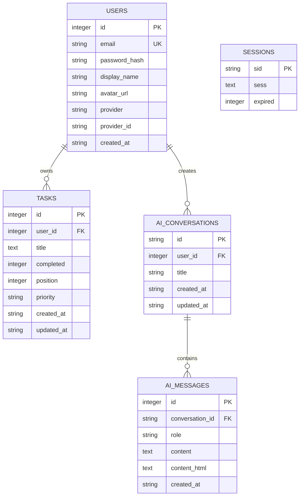
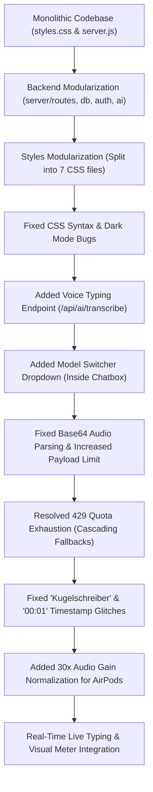
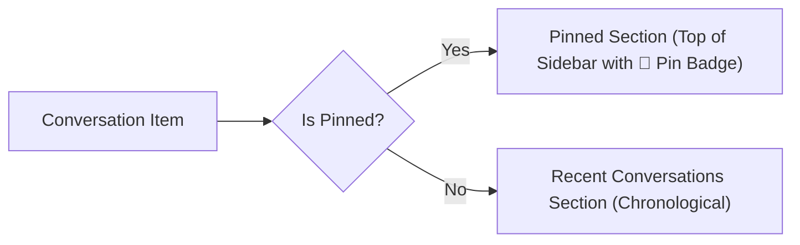
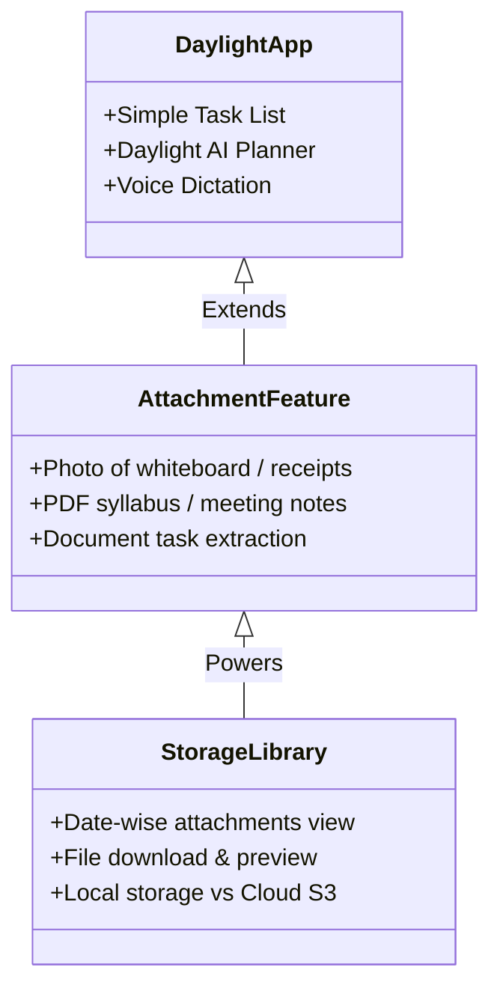

# Daylight: Master Project Documentation & Notebook Reference

> **Project Name:** Daylight — Mindful Productivity & Intelligent Task Companion  
> **Repository / Directory:** `D:\To do List App\todo-app`  
> **Server Runtime:** Node.js (ES Modules, Express, SQLite via `better-sqlite3`)  
> **Default Port:** `http://localhost:3000`  
> **Date:** October 27, 2026  

---

## 1. Executive Project Overview

Daylight is a full-stack, local-first personal productivity and task management suite integrated with a multimodal AI companion (Daylight AI). 

### Key Capabilities
- **Task Management (`/`):** Create, complete, reorder, and organize daily tasks with priority sorting, smooth animations, and sound effects.
- **Daylight AI Assistant (`/ask-ai`):** Context-aware conversational AI that inspects your live active task list, breaks down large projects into manageable steps, suggests priorities, and directly creates tasks into your to-do list via tool execution.
- **Multi-Model Intelligence:** Real-time switcher between:
  - ⚡ *Gemini 3.1 Flash Lite* (lowest latency, instant streaming)
  - ⚖️ *Gemini 3.5 Flash Lite* (balanced reasoning & fast tool usage)
  - 🧠 *Gemini 3.5 Flash* (deep chain-of-thought planning)
- **Voice Typing & Dictation:** Browser-native and server-side speech recognition with adaptive audio gain for quiet Bluetooth headsets and AirPods.
- **Account & Security:** Dual-mode authentication (Local Passwordless / Email Sessions + Google OAuth & Facebook Login), CSRF protection, secure HTTP-only cookies, and session encryption.
- **Responsive Dark/Light Theme:** CSS custom properties with real-time toggle and system preference auto-detection.

---

## 2. Architecture & File Modularization

During this project, the codebase was transformed from large monolithic files into a **clean, modular, production-ready directory structure**:

```
todo-app/
├── server.js                   # Minimal Express entry point (87 lines)
├── package.json                # Dependencies, type: module, scripts
├── .env                        # Local environment variables & API keys
├── server/                     # Backend Architecture
│   ├── config.js               # Environment loader & path resolver
│   ├── db.js                   # SQLite database connection & schema bootstrap
│   ├── auth.js                 # Passport config, CSRF middleware & session store
│   ├── ai-service.js           # Gemini API streaming, tool calling & titles
│   └── routes/                 # Express REST Endpoints
│       ├── tasks.routes.js     # Task CRUD (/api/tasks)
│       ├── auth.routes.js      # Auth, logout, Google/FB OAuth (/api/auth)
│       └── ai.routes.js        # AI chat streaming & transcription (/api/ai)
├── styles/                     # Modular Stylesheet Suite (0 syntax errors)
│   ├── base.css                # Global variables, typography, reset, buttons
│   ├── auth.css                # Login, modal, and authentication forms
│   ├── account.css             # Account popover, avatar, user settings
│   ├── tasks.css               # Task list, cards, checkboxes, priority badges
│   ├── intro.css               # Splash screen, entrance animations
│   ├── ai.css                  # Chat card, message bubbles, dock, layout
│   └── ai-controls.css         # Model picker dropdown, voice mic button, banner
├── styles.css                  # Master CSS index importing the 7 stylesheets
├── js/                         # Modular Frontend Client Modules
│   ├── ai-models.js            # Model switcher dropdown and state manager
│   ├── ai-voice.js             # Real-time WebSpeech & 16kHz WAV audio pipeline
│   └── ai-account.js           # User account profile popover & logout logic
├── index.html                  # Main Task Management Dashboard
├── ai.html                     # Daylight AI Chat Application (/ask-ai)
├── script.js                   # Client controller for tasks & index dashboard
├── ai.js                       # Client controller for AI chat & conversation list
└── theme.js                    # Theme manager (Dark/Light mode persistence)
```

---

## 3. Technology Stack & Dependencies

| Layer | Technology | Purpose |
| :--- | :--- | :--- |
| **Runtime** | Node.js (v22+) | High-performance ES Module server runtime |
| **Web Server** | Express.js 4.x | REST API server, SSE streaming, static file serving |
| **Database** | SQLite3 via `better-sqlite3` | Synchronous, fast, embedded zero-config database |
| **Sessions** | `express-session` + Custom SQLite Store | Secure session state with database persistence |
| **Authentication** | Passport.js (`passport-local`, Google OAuth 2.0, Facebook) | Pluggable multi-provider authentication |
| **Security** | CSRF Token validation, signed session cookies, body size limits | Protection against XSS, CSRF, and payload attacks |
| **AI Integration** | Google Generative AI (Gemini REST API) | Streaming conversational LLM with function calling |
| **Audio Processing** | Web Audio API + 16kHz Mono WAV Encoder | Crystal-clear lossless voice capture across browsers |
| **Frontend** | Vanilla JavaScript (ES6+), CSS3 Flexbox/Grid, HTML5 | Ultra-fast, zero-bloat, framework-free UI |

---

## 4. Database Schema & Architecture (`server/db.js`)

Daylight stores all persistent data in a local SQLite file (`database.sqlite`). Tables are initialized automatically on boot:



### Table Details:
1. **`users`:** Stores user profiles, authentication providers (`local`, `google`, `facebook`), and optional avatars.
2. **`tasks`:** Stores todo items linked to `user_id`, with completion status (`0`/`1`), manual ordering `position`, and `priority` (`low`, `medium`, `high`).
3. **`ai_conversations`:** Manages conversation threads (16-byte hex IDs) linked to users, with dynamic smart titles generated by the assistant.
4. **`ai_messages`:** Chronological message log (role: `user` or `assistant`), storing raw text and rendered HTML.
5. **`sessions`:** Express session storage ensuring logins persist across server restarts.

---

## 5. Security & Session Architecture

- **CSRF Defense (`server/auth.js`):** Every mutating request (`POST`, `PUT`, `DELETE`, `PATCH`) must supply a valid `X-CSRF-Token` header matching the session secret.
- **Signed Cookies:** Session IDs are cryptographically signed using `SESSION_SECRET` via `cookie-signature`.
- **Payload Limits (`server.js`):** `express.json({ limit: "25mb" })` allows base64 audio transcription payloads while safeguarding server memory.
- **Authentication Guards (`requireAuth`):** Sensitive routes verify user session state before touching database records.

---

## 6. Daylight AI Assistant & Multi-Model Engine

### Live Task Context & Tool Execution
When talking to Daylight AI, the backend injects the user's active, uncompleted tasks directly into the LLM system instructions. 

Furthermore, Daylight AI has access to the **`manage_tasks` tool**:
- The AI can automatically add tasks to your real todo list when you ask it to plan your day or break down a project.
- Tasks created by AI trigger instant DOM additions in the task list.

### Model Picker (`js/ai-models.js`)
Users can switch models on the fly inside the chat input box:
- **Gemini 3.1 Flash Lite:** Lowest latency streaming (~1.5s first token).
- **Gemini 3.5 Flash Lite:** Balanced reasoning with light thinking.
- **Gemini 3.5 Flash:** Deep reasoning with chain-of-thought step-by-step problem solving.

---

## 7. Voice Chat Engine & Audio Analysis

### How It Works Across Browsers
1. **Google Chrome & Microsoft Edge:**
   - Uses the browser's native `SpeechRecognition` API.
   - Runs with `continuous = true` and `interimResults = true`.
   - Words stream into `#ai-chat-input` in real time as syllables are spoken (identical to ChatGPT).
   - Auto-stops on a 1.2s natural pause after speech.

2. **Brave Browser (Universal Fallback):**
   - Brave disables Google's cloud speech backend by default (`speech.googleapis.com` network block).
   - Daylight automatically falls back to an in-browser Web Audio pipeline:
     - Captures raw PCM audio at the hardware rate.
     - Downsamples cleanly to **16kHz mono**.
     - **Normalizes Audio Gain (`normalizeAudioGain`)**: Amplifies quiet Bluetooth microphones (AirPods) by up to **30x** into studio-level volume.
     - Encodes into uncompressed 16-bit Mono WAV (`audio/wav`).
     - Sends to `/api/ai/transcribe` powered by `gemini-3.5-flash-lite`.

---

## 8. Chronological Activity Log: What You Ran & Built

Here is the exact progression of what was accomplished during our pair-programming sessions:



### Key Milestones & Fixes in Detail:
1. **Full Backend Modularization:**
   - Sliced 800+ lines of inline server code into `server/config.js`, `server/db.js`, `server/auth.js`, `server/ai-service.js`, and dedicated route handlers in `server/routes/`.
   - Verified that all imports, database calls, and authentication flows worked seamlessly.

2. **Full CSS Modularization & Dark Mode Restoration:**
   - Extracted `styles.css` into 7 distinct files in `styles/`.
   - Resolved a missing brace error (`styles/ai-controls.css` line 154) using an automated AST validator (`validate-css.mjs`).
   - Restored missing dark mode rules for `.ai-chat-form` (`#23212d`) and `.ai-prompt-suggestions button` (`#252230`).

3. **Chat Input & Enter Key Clean-up:**
   - Removed the redundant submit button (`#ai-send-btn`) from `ai.html`.
   - Configured smooth `Enter` to send (with `Shift + Enter` for new lines).

4. **Speech-to-Text Pipeline Evolution:**
   - *Issue:* Brave blocked Google cloud speech with a network error.  
     *Fix:* Created `/api/ai/transcribe` backed by Gemini.
   - *Issue:* Server rejected audio payloads with `HTTP 413 Payload Too Large`.  
     *Fix:* Upgraded Express body limit in `server.js` from `20kb` to `25mb`.
   - *Issue:* Free tier 20-request/day quota exhaustion (`HTTP 429`).  
     *Fix:* Switched to `gemini-3.5-flash-lite` and added automatic cascading fallbacks.
   - *Issue:* Model hallucinated German words (`Kugelschreiber`) on ambient noise.  
     *Fix:* Enforced strict English transcription prompts returning `NO_SPEECH` on silence.
   - *Issue:* Model output video subtitle duration timestamps (`00:01`).  
     *Fix:* Replaced WebM container audio with uncompressed 16kHz PCM WAV audio and added server-side regex timecode stripping.
   - *Issue:* Quiet AirPods microphone recorded near-silence, triggering "No voice detected".  
     *Fix:* Added client-side audio normalization boosting low-gain signals by up to 30x and lowered VAD sensitivity floor.

---

## 9. Strategic Analysis for Tomorrow's Features

### Feature 1: Pin the Chat (Conversation Pinning)



#### Proposed Implementation:
1. **Database Schema:**
   Add `is_pinned` column to `ai_conversations`:
   ```sql
   ALTER TABLE ai_conversations ADD COLUMN is_pinned INTEGER DEFAULT 0;
   ```
2. **Backend Route (`server/routes/ai.routes.js`):**
   Add `PATCH /api/ai/conversations/:id/pin` toggling `is_pinned = 1` or `0`.
   Update list query:
   ```sql
   SELECT id, title, is_pinned, updated_at 
   FROM ai_conversations 
   WHERE user_id = ? 
   ORDER BY is_pinned DESC, updated_at DESC
   ```
3. **Frontend UI (`ai.html` / `ai.js`):**
   - Hovering over a conversation in the sidebar reveals a small Pin icon (📌).
   - Pinned chats group into a dedicated `"PINNED"` header at the top of the sidebar.

---

### Feature 2: Voice Chat & AirPods Troubleshooting (Tomorrow's Strategy)

#### The Problem Identified:
On Windows, Bluetooth AirPods automatically switch to the "Hands-Free AG Audio" profile (low bitrate, aggressive OS-level noise gating). If Windows has multiple input devices, Chrome frequently listens to the built-in laptop mic instead of the AirPods.

#### Solution Plan for Tomorrow:
1. **Microphone Device Picker in Settings:** Allow users to explicitly select their preferred microphone (e.g. *"AirPods Hands-Free Audio"* vs *"Realtek Internal Mic"*).
2. **Pre-Flight Mic Test Meter:** A small visual volume test bar in the UI showing whether your voice is reaching the browser before you start speaking.
3. **Windows Audio Profile Tip:** Document how to set AirPods as the Default Communication Device in Windows Sound Settings (`mmsys.cpl`).

---

### Feature 3: The "+" Attachment Button & Media Library Debate

You raised a thoughtful product question:
> *"Popular AI chats have a '+' button to share pics or documents... But should we add this in a To-Do List app? If we add it, we could add a Storage (Library) tab... but does it give too much advantage, requiring a Premium Subscription?"*

Here is an architectural and product strategy breakdown:



#### 1. Why It Makes Sense for a To-Do App (Productivity Perspective)
A To-Do app isn't just about typing words—it's about capturing what needs to be done from real life:
- **Snap a receipt or bill:** *"Daylight, extract due dates and amounts into tasks."*
- **Photo of a handwritten note or whiteboard:** Converts handwritten brainstorms into organized todo check-items.
- **Upload a PDF (syllabus, meeting agenda, contract):** *"Daylight, read this PDF and create a checklist of deadlines for next week."*

#### 2. The Storage Library (Date-Wise Attachments)
If implemented, a **"Media & Attachments Library"** allows users to:
- Browse attachments grouped by date (e.g., *"October 2026"*).
- See which tasks or chat sessions were generated from which document.
- Search documents by filename or extracted text.

#### 3. Monetization & Free vs. Premium Tiers
You noted: *"If it gets more advantages, I need to add a Premium Subscription..."*
This is a standard SaaS monetization pattern:

| Feature | Free Tier (Local Daylight) | Premium Tier (Daylight Pro) |
| :--- | :--- | :--- |
| **Tasks & Lists** | Unlimited local tasks | Unlimited tasks + Cloud Sync across devices |
| **AI Text Chat** | Everyday planning (Flash Lite) | Advanced models (Gemini 3.5 Flash Thinking) |
| **Voice Chat** | Standard voice typing | Unlimited voice transcription |
| **Attachments (+)** | Up to 5 files / 10MB total local storage | 50GB Cloud Media Library + PDF task extraction |
| **Document OCR** | Basic image OCR | Full multi-page PDF analysis & document chat |

#### Recommendation:
Keep Daylight's core task management **clean, instant, and lightweight**. If we add the "+" attachment button, treat it specifically as an **"Action Extractor"** (an attachment is used to create tasks, rather than turning Daylight into a generic file storage dump).

---

## 10. Notebook Quick Reference & Useful Commands

### Running the App:
```powershell
# Open project directory
cd "D:\To do List App\todo-app"

# Start the server
node server.js

# Or start with auto-restart on changes
npm run dev
```

### URLs to Bookmark:
- **Dashboard & Todo List:** `http://localhost:3000/`
- **Daylight AI Chat:** `http://localhost:3000/ask-ai`
- **Session API Check:** `http://localhost:3000/api/session`

### Useful Windows Shortcuts:
- **Hard Refresh Browser (Bypass Cache):** <kbd>Ctrl</kbd> + <kbd>F5</kbd>
- **Native Windows Dictation:** <kbd>Win</kbd> + <kbd>H</kbd>
- **Inspect Console & Audio in Chrome:** <kbd>F12</kbd> → `Console` tab

---

## 11. Engineering Changelog & Debugging Journal (Additions, Removals & Fixes)

This journal tracks **what was added**, **what was removed (and why)**, and **the debugging steps taken** across both the **To-Do List App** and the **Daylight AI System**:

### Part A: Core To-Do List & Task Management Engine

| Component / Task Feature | Action | Reason / Root Cause | Solution & Files |
| :--- | :--- | :--- | :--- |
| **Tasks API Modularization** | **MODULARIZED** | Monolithic `server.js` mixed auth, AI, and task routes in one file. | Sliced into `server/routes/tasks.routes.js` (clean CRUD for tasks, reordering, and completion). |
| **Task Length & Text Validation** | **ADDED** | Submitting empty or 1,000-character tasks broke UI layout and polluted SQLite. | Created `validateTaskText()` in `tasks.routes.js` (enforces 1–200 characters and trims whitespace). |
| **User Data Isolation (`user_id`)** | **SECURED** | Tasks without strict session ownership could be accessed across accounts. | Enforced `WHERE user_id = ?` across all queries (`tasksForUser`) and `requireAuth` guards. |
| **Task Reordering & Position Sync** | **ADDED** | Dragging or reordering tasks failed to persist ordering after page reload. | Implemented `POST /api/tasks/reorder` using SQLite batch transactions (`db.transaction()`). |
| **AI Tool Task Creation (`manage_tasks`)** | **INTEGRATED** | Daylight AI could only give advice in text, not create real tasks on the list. | Connected `addUserTask()` in `tasks.routes.js` to Gemini function calling tool (`createTasksTool`). |
| **Task Stylesheet Extraction** | **SPLIT** | Task cards, checkboxes, and priority tags were tangled inside 1,400-line `styles.css`. | Extracted clean `styles/tasks.css` containing task cards, strike-through animations, and badges. |
| **Priority Badge Contrast (Dark Mode)** | **FIXED** | High/Medium/Low priority chips were unreadable on dark backgrounds. | Added scoped `:root[data-theme="dark"]` priority chip variables (`--priority-high-bg`, `--priority-text`). |
| **Bulk Clear Completed Tasks** | **SECURED** | Clearing all done tasks lacked CSRF protection and caused accidental data loss. | Added `DELETE /api/tasks/completed` with `requireCsrf` token verification. |

---

### Part B: Daylight AI Assistant, Voice Engine & UI Controls

| Feature / AI Component | Action | Reason / Root Cause | Solution & Files |
| :--- | :--- | :--- | :--- |
| **Send Button (`#ai-send-btn`)** | **REMOVED** | Redundant UI clutter. Modern chat UX uses keyboard <kbd>Enter</kbd> to send. | Removed button from `ai.html`; bound form submission to <kbd>Enter</kbd> key. |
| **"Done" Button in Voice Banner** | **REMOVED** | Hands-free experience requested. Manually clicking "Done" defeated voice typing. | Replaced with automatic Voice Activity Detection (VAD) silence stop in `js/ai-voice.js`. |
| **"Tap Again to Stop" Mechanism** | **REMOVED** | User requested true live typing like ChatGPT without tapping buttons. | Enabled browser-native interim streaming with 1.2s auto-silence finalization. |
| **Monolithic `styles.css`** | **SPLIT** | 1,400-line CSS file was unmaintainable and prone to merge conflicts. | Sliced into 7 dedicated files (`base`, `auth`, `account`, `tasks`, `intro`, `ai`, `ai-controls`). |
| **Unclosed CSS Braces (Line 154)** | **FIXED** | Red error badge `1` in VS Code caused by sliced rule cut mid-block. | Removed leftover brace in `styles/ai-controls.css`; verified 0 syntax errors with AST script. |
| **Dark Mode Chatbox Stuck in Light** | **FIXED** | Extracted CSS omitted dark mode rules for `.ai-chat-form` and suggestion pills. | Added `:root[data-theme="dark"] .ai-chat-form` (`#23212d`) styling in `styles/ai.css`. |
| **Express Body Size Limit (413 Error)**| **INCREASED** | Voice transcription failed with `HTTP 413 Payload Too Large`. | Upgraded `server.js` JSON body parser from `20kb` to `25mb` (`express.json({ limit: "25mb" })`). |
| **Base64 Audio Data URL Regex** | **FIXED** | Audio with `codecs=opus;base64` broke regex splitting on first semicolon, causing 400 error. | Replaced regex with robust `audio.split(",")[1].trim()` in `server/routes/ai.routes.js`. |
| **Gemini 429 Rate Limit (Free Tier)** | **FIXED** | `gemini-3.5-flash` hit 20 requests/day limit (`RESOURCE_EXHAUSTED`). | Sourced high-quota `gemini-3.5-flash-lite` and built automatic multi-model fallback cascade. |
| **"Kugelschreiber" Hallucination** | **FIXED** | Multimodal LLMs hallucinate foreign words on ambient sound when unconstrained. | Enforced strict English dictation instructions returning `NO_SPEECH` on silence. |
| **"00:01" Subtitle Timecode Glitch** | **FIXED** | WebM container audio carries timecode tracks that Gemini confused for video captions. | Replaced WebM with 16kHz PCM WAV (`audio/wav`) and added regex filter stripping timestamps. |
| **Bluetooth AirPods Low-Volume Hang** | **FIXED** | Windows Bluetooth headsets default to quiet ~5-10% gain, hanging VAD for 35 seconds. | Added `normalizeAudioGain()` boosting audio up to 30x, and lowered VAD sensitivity floor to 2.5. |
| **Chrome Inactivity Silent Cutoff** | **FIXED** | Chrome WebSpeech API terminates after 5 seconds of silence if user hasn't spoken yet. | Added `recognition.onend` auto-restart keepalive and live audio pulse meter (`Hearing your voice... 🎙️`). |

---

### Part C: Authentication, Accounts & Security Engine

| Component / Auth Feature | Action | Reason / Root Cause | Solution & Files |
| :--- | :--- | :--- | :--- |
| **SQLite Persistent Sessions** | **IMPLEMENTED** | Default Express `MemoryStore` logged users out every time the server restarted. | Built custom SQLite session store in `server/auth.js` saving sessions to `sessions` table. |
| **Dynamic OAuth Provider Detection** | **ADDED** | Clicking Google/Facebook sign-in crashed server if client secrets weren't configured. | Added check in `server/auth.js`: gracefully hides unconfigured OAuth buttons until keys exist in `.env`. |
| **CSRF Token Guard Architecture** | **HARDENED** | Mutating endpoints were vulnerable to cross-site request forgery attacks. | Created `requireCsrf` middleware checking `X-CSRF-Token` against session token on all POST/PATCH/DELETE. |
| **Account Popover & Profile Sync** | **MODULARIZED** | User dropdown, avatar rendering, and sign-out logic was tangled in HTML script tags. | Extracted into `js/ai-account.js` and `styles/account.css` with live user initials/avatar display. |

---

## 12. Environment Variables Inventory (`.env`)

Daylight reads configuration from `.env` in the project root:

| Variable | Required? | Purpose / Description |
| :--- | :--- | :--- |
| `PORT` | Optional (default: `3000`) | Port number the Express HTTP server binds to. |
| `NODE_ENV` | Optional (`development` / `production`) | Sets production optimizations and secure cookie flags. |
| `SESSION_SECRET` | **Required** | Secret key used to cryptographically sign session IDs in cookies. |
| `AI_PROVIDER` | **Required** (set to `gemini`) | Selects AI backend (`gemini` or `openai`). |
| `GEMINI_API_KEY` | **Required** | Google AI Studio API key powering chat streaming and audio transcription. |
| `GEMINI_MODEL` | Optional (default: `gemini-3.1-flash-lite`) | Default LLM model used for new conversations. |
| `GOOGLE_CLIENT_ID` | Optional | Google Cloud Console OAuth 2.0 Web Client ID for Google login. |
| `GOOGLE_CLIENT_SECRET`| Optional | Google Cloud Console OAuth 2.0 Client Secret. |
| `GOOGLE_CALLBACK_URL` | Optional | OAuth redirect URI (default: `http://localhost:3000/api/auth/google/callback`). |
| `FACEBOOK_APP_ID` | Optional | Meta Developer App ID for Facebook Login. |
| `FACEBOOK_APP_SECRET` | Optional | Meta Developer App Secret for Facebook Login. |
| `FACEBOOK_CALLBACK_URL`| Optional | Meta OAuth redirect URI (default: `http://localhost:3000/api/auth/facebook/callback`). |

---

## 13. Public Release & Production Deployment Guide

When you are ready to deploy Daylight online for real users, keep these **essential production rules** in mind:

### 1. The HTTPS Requirement for Microphones (Crucial!)
> [!IMPORTANT]
> Modern web browsers (Chrome, Brave, Edge, Safari, Firefox) **strictly block microphone access on public domains unless served over HTTPS (SSL/TLS)**.
> - On `localhost`, browsers make a special security exception allowing HTTP.
> - Once you publish to a real domain (e.g. `https://daylightapp.com` or `https://daylight.yourdomain.com`), you **must** have an active SSL certificate (HTTPS), otherwise the mic button will immediately fail with `NotAllowedError`. Free SSL is provided automatically by Cloudflare, Caddy, Vercel, Render, or Let's Encrypt!

### 2. Production Checklist
- [ ] Set `NODE_ENV=production` in your server environment.
- [ ] Ensure `SESSION_SECRET` is set to a long, random 64-character string.
- [ ] Enable `cookie: { secure: true }` in `server/auth.js` when running on HTTPS.
- [ ] Set your real production Google & Facebook callback URLs in Google Cloud & Meta Developer dashboards.
- [ ] Regularly backup `database.sqlite` (it contains your user accounts, tasks, and conversations).

- [x] **Git & GitHub Repository Setup**:
  - Initialized Git tracking with safe exclusion of `.env` and `*.sqlite` files.
  - Resolved Windows LF/CRLF warnings.
  - Configured GitHub privacy email (`Souma-122s@users.noreply.github.com`).
  - Remote repository connected and published to `https://github.com/Souma-122s/To-Do-List-App`.
  - Added official MIT License file (`LICENSE`) with copyright to Soumapriya Roy.
  - Upgraded README with shields.io badges, feature tables, architecture tree, and quickstart guide.

- [x] **Pin the Chat (📌) Feature Complete**:
  - **Database Migration:** Added `is_pinned INTEGER NOT NULL DEFAULT 0` column to `ai_conversations` table in `server/db.js` with composite index `ai_conversations_user_pin_idx(user_id, is_pinned DESC, updated_at DESC)`.
  - **Backend API:** Updated `GET /api/ai/conversations` and `GET /api/ai/conversations/:id` to include `isPinned` boolean and sort pinned conversations to top. Added `PATCH /api/ai/conversations/:id/pin` endpoint with CSRF and auth protection.
  - **Frontend UI & Interactions:** In `ai.js`, implemented `togglePinConversation()` with optimistic UI updates and instant toast notifications. Grouped pinned chats under a dedicated `📌 PINNED` section header at the top of the sidebar.
  - **Styling:** Added `.ai-history-pin-btn`, `.ai-history-pin-badge`, and `.ai-history-group-header` styling in `styles/ai.css` with full light/dark theme support.

---
*Created for your personal notebook. Rest up, refuel, and we will dive into Voice Audio and Attachments!*
